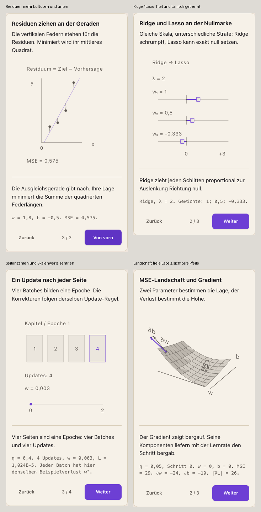

# Figuren S5: Optimierung im Lektionsfluss

Stand 18.10.2026, Fortsetzung der Sitzung vom 17.10. Arbeitszweig `feature/figuren-s5`, Basis `2836575e2f6f62f51d1e7c618bdd4a249ecb5309` (Integration Welle 1), anfangs sauber. Normaler Git-Worktree `/Users/no8/Desktop/life/Lifemaxxing/argmin-figuren-s5`. Kein Push, kein Merge. Port ausschließlich 4405 mit `--strictPort`.

## Frühe Anfragen an den Integrator

- **Explore-Eingabe:** `FigureRuntime.tsx` berechnet sein Modell ausschließlich aus `spec.params`. `spec.explore` wird weder gelesen noch als Eingabe gerendert. Benötigter Vertrag: beschriftetes Zahlenfeld nach `{parameter,min,max,step,input:'number'}`; endliche und bereichsgültige Werte erst nach `scene.validateParams` übernehmen; bei Änderung `scene.model({...params,[parameter]:value})` neu berechnen, Pose und Kamerazustand definiert zurücksetzen, Antwortzustand nach Parametersatz trennen. Vertikale Touch-Gesten und Textauswahl außerhalb der Bühne erhalten. Für F7 heißt der Parameter `eta`. Kein lokaler Ersatz der Runtime.
- **Compare-Bedienung:** `spec.compare.a/b` wird nicht ausgewertet. Benötigter Vertrag: zwei ausdrücklich benannte Parametersätze durch denselben Modell-/Build-Pfad, gleiche Kamera und gleiche Achsengrenzen. Mobil ein zugänglicher A/B-Umschalter oder zwei lesbare große Ansichten untereinander. Für F7 Vergleich von Ridge und Lasso bei gleichem `lambda`. Keine private A/B-Hülle im Familienzweig.
- **Canvas unter SVG:** Painter und Engine besitzen keinen Canvas-Layer. Vor einer gemeinsamen Erweiterung 400 Kacheln mit identischer Projektion und Datenmenge messen. Ein möglicher Vertrag muss Größe/DPR, Kamera, Theme, Reduced Motion, Forced Colors, Druck und das Pausieren außerhalb des Viewports gemeinsam behandeln. Die Familie liefert reine Geometrie, keine zweite Engine.
- **Szenen-Aufgabe und Hinweise:** `pick-learning-rate` hat hier keinen zugewiesenen Aufgabenvertrag. Kein eigener Grader. Neue Hinweise erst mit sicherem Fall-/Nachbarvertrag und bestehender Lecksperre; das gesuchte neue Gewicht darf auch durch die Geometrie nicht erkennbar sein.

## Entwurf vor Detailgeometrie

| Figur | Lernfrage und angrenzende Lektüre | Beispiel und Darstellung | Notwendige Teile und mobile Ansicht |
|---|---|---|---|
| mse-landscape | Wie werden aus zwei partiellen Ableitungen ein Schritt und eine Spur? Die Regression erklärt MSE, partielle Ableitung und Update-Regel. | Kleine feste Regressionsdaten; räumliche Verlustfläche, weil Höhe den Verlust über zwei unabhängigen Parametern zeigt. `viewMode=spatial`. | Fläche ohne scheinbare Zellgrenzen, Höhenlinien, Punkt, Komponenten und berechnete Spur. Zahlen in der gemeinsamen Beschreibung; keine zweite Tafel. Anfang, Gradient und Lauf bei 343 px zuerst prüfen. |
| residual-springs | Warum ziehen große Residuen stärker an der Ausgleichsgeraden? Die Lektüre definiert Residuum und MSE. | Vier Punkte des geschützten Beispiels, vertikale Federn, dann Ausreißer und neu gefittete Gerade. Frontal, gleicher Maßstab beider Datenachsen. | Punkte, Gerade, Federn, MSE. Keine Steckbrett-Requisiten. Auf Mobil eine große Ansicht. |
| rubber-band-coefficients | Warum schrumpft Ridge, während Lasso Gewichte exakt null setzt? Die Lektüre erklärt L2/L1 und Feature-Selektion. | Orthogonaler Fall mit positiven und negativen Koeffizienten. Vergleich bei identischer Strafe und Skala. `viewMode=flat`. | Nullmarke, drei Schienen, Positionen, Zug zur Null. Nur ein Verfahren pro mobilem Zustand; keine winzigen Doppelplots. |
| training-book | Wie hängen Batch, Update und Epoche zusammen? Die Lektüre beschreibt den Trainingsablauf und die Lernrate. | Vier Seiten pro Kapitel; ein Update pro Seite. Der Gewichtsverlauf entsteht aus Gradienteniteration. `viewMode=flat`. | Vier Seiten, aktueller Batch, Updatezahl und Gewicht. Keine vollständige Raumkulisse. |
| early-stopping-flag | Warum das frühere Modell behalten, wenn der Trainingsfehler weiter fällt? Die Lektüre erklärt Validierung und Patience. | Explizit schematische Train-/Validierungskurven des geschützten Checkpoints. Minimum über diskrete Epochen berechnen. `viewMode=flat`. | Zwei beschriftete Kurven mit unterschiedlicher Linie, Marker am besten Modell und aktueller Stand. Genügend Abstand für 14 px Text. |

## Prüfstand

Die fünf angefragten Figuren sowie die frontale Sekantenfigur sind in den jeweiligen Lektionsfluss eingebunden. Die bestehenden Texte wurden an den Einfügestellen aufgeteilt; alle sechs geschützten Checkpoints sind bis auf die neue Beat-Zuordnung unverändert. Die alten `.viz.json` bleiben unverändert erhalten und werden durch eine lokale Archivlektion referenziert. Es wurden keine dauerhaften Tests oder Snapshot-Assertions ergänzt.

Modell, Pose und Geometrie bleiben getrennt. Die Familienmodule enthalten weder DOM-Steuerung noch einen eigenen Runtime-/Painter-/Canvas-Zweig. Gemeinsame Runtime, Engine, Painter, CSS, Schemas und der Figurenabschnitt des Compilers wurden nicht geändert. Registry und öffentliche Allowlist erhielten die nötigen Einträge. [Asset-Karten](figuren-s5/assets.md) dokumentieren Datenbereiche, Vereinfachungen und Grenzen jedes Moduls.

### Fachliche Gegenprüfung

Ein einmaliges Prüfskript hat 67 Fälle mit den tatsächlichen Python-`referenceSolver`-Strings aus `optimize-mse-gradient-closed-form` und `formula-ridge-lasso-closed-form` sowie zentralen Differenzen verglichen:

| Prüfung | Ergebnis |
|---|---|
| Analytische MSE/Gradienten gegen Referenz | Größte absolute Abweichung `8,8818e-16` |
| Numerischer Gradient in begrenzten Verlustbereichen | Größte absolute Abweichung `1,7060e-6` |
| Orthogonale Ridge-/Lasso-Koeffizienten | Abweichung `0` |
| Rekurrenz der zwölf Gradientenschritte | Abweichung `0` |
| Verlust an Mesh-Stützstellen | Größte absolute Abweichung `7,1054e-15` |
| Lernraten `0,005 / 0,05 / 0,15` | Keine Divergenz nach dem definierten Kriterium |
| Lernraten `0,25 / 0,3` | Drei aufeinanderfolgende Verlustanstiege ab Schritt 3 |
| Alte Checkpoints | Alle sechs JSON-inhaltsgleich, zusätzliche Beat-Zuordnung ausgenommen |

Die MSE-Szene verwendet die Lektionspunkte `(1,3)` und `(3,7)`. Die Spur zeigt echte Updates; außerhalb des sichtbaren Bereichs werden Gewichte nicht geklemmt. Linien werden am Ausschnitt geschnitten, der Readout benennt den Austritt beziehungsweise die Divergenz. Bei `eta=0,005 / 0,05 / 0,25` ergeben zwölf Schritte MSE `6,865 / 0,003 / 169864555,603`. Diese Varianten wurden einmalig mit derselben gemeinsamen FigureBlock/Runtime und unterschiedlichen verfassten Parametern geprüft; die temporäre Review-Seite ist entfernt.

Ridge und Lasso folgen den unterschiedlichen Normierungen der bestehenden Referenzaufgaben; dies steht auch im Lektüretext. Das Trainingsbuch berechnet acht Updates auf `L(w)=w²` mit festem Bias. Die Early-Stopping-Kurven sind ausdrücklich schematisch: bestes Modell bei Epoche 6, Stopp bei 9 für Patience 3, Rückwahl von 6.

### SVG/Canvas-Entscheidung und Laufzeit

Der isolierte Vergleich gleicher 400 Kacheln bei 343 px und vierfacher CPU-Drosselung ergab über drei Läufe als Median der Mediane SVG `2,4 ms`, Canvas `0,7 ms` ([Rohwerte](figuren-s5/svg-canvas.tsv)). Canvas ist damit der bevorzugte Kandidat für einen gemeinsamen Flächenlayer. Ein entsprechender Integratorvertrag fehlt weiterhin.

In der tatsächlichen gemeinsamen Runtime kosteten 400 SVG-Kacheln rund `22 ms` pro Beat und `39 ms` beim Drehen. Die einzelne Änderung von `20×20` auf `8×8` Renderkacheln senkte dies auf etwa `3 / 6 ms`, bei unverändertem mathematischen Modell. Die 64 Kacheln verwenden je zwei Dreiecke; Höhenlinien und Spur werden direkt berechnet. Die lineare Interpolation zwischen Stützstellen bleibt eine Darstellungsnäherung.

Nach der letzten Layoutkorrektur wurden drei vollständige Läufe in den echten Lektionen wiederholt, CPU vierfach gedrosselt. Der abschließende Drag-Lauf scrollt die Bühne ausdrücklich in den Viewport und verlangt mehr als zehn gemessene Ticks. Ergebnis für die MSE-Szene bei **375 und 1440 px jeweils: Beat `3,9 ms`, Drag `7,2 ms`** (Median der drei Laufmediane). Damit sind `<4 ms` und `<8 ms` im vereinbarten Median erfüllt; einzelne Beat-Läufe lagen bei `4,1 ms`. Die übrigen Szenen benötigen `0,9–1,4 ms` pro Beat. [Messhistorie](figuren-s5/perf-hillclimb.tsv), [abschließende Rohwerte](figuren-s5/final/performance-drag-spacing.json).

`performance-spacing.json` enthält einen früheren Desktop-Drag-Versuch ohne verwertbare Ticks, weil die Bühne außerhalb des Viewports lag. Dafür wird ausschließlich der korrigierte Lauf `performance-drag-spacing.json` gewertet.

### Bundlegrößen

Release-Build, Node `zlib.gzipSync` mit Standardeinstellung, Bytes; gemeinsame Chunks separat gerechnet:

| Chunk | gzip |
|---|---:|
| mse-landscape | 2755 |
| mse-section | 1097 |
| residual-springs | 1160 |
| rubber-band-coefficients | 1230 |
| training-book | 1188 |
| early-stopping-flag | 1311 |
| Gemeinsame F7-Modelle/Plot-Helfer (`optimization-plot`) | 1747 |
| Gemeinsame Bühne (`linalg-stage`) | 1018 |
| Gemeinsames Figuren-Kit | 5975 |
| Gemeinsame FigureRuntime | **10003** |

Alle Szenenchunks liegen unter 12000 Bytes; auch der größte Szenenchunk plus F7-Helfer, Bühne und Kit liegt darunter (`11495` Bytes). Die gemeinsame Runtime liegt **3 Bytes über dem strikten 10000-Byte-Ziel**. Sie ist gegenüber der Basis unverändert und gehört dem Integrator; eine höhere gzip-Stufe wird nicht als bestandene Messung ausgegeben.

### Visuelles Review und Bedienung

Die ursprüngliche Abschlussserie umfasst 76 Zustände. Nach Noas Abstandskorrekturen wurden weitere 52 Zustände bei 375/1440 px und in beiden Themes geprüft. Die aktuelle Fassung von MSE-Landschaft, Residuen, Ridge/Lasso und Trainingsbuch liegt unter [spacing-review/](figuren-s5/spacing-review/); Sekante, Early Stopping und die Lernratenvarianten unter [final/](figuren-s5/final/). Frühere Bilder sind als Iterationsnachweis erhalten.

Die letzte Korrektur vergrößert die Abstände zwischen Residuum-Titel, Y-Achse und MSE sowie zwischen Ridge/Lasso-Titel und λ. Die Seitennummern liegen mittig in ihren Boxen; 0 und 2 haben dieselbe Baseline und sind an den Endpunkten zentriert. Die Landschaftskamera berücksichtigt sämtliche sichtbaren Geometrien und Beschriftungen; `w`, `b`, `∂w` und `∂b` sind vollständig sichtbar. Pfeilköpfe werden mit dem vollständigen räumlichen Vektor normiert, die Striche bleiben in tatsächlichen Bildschirmpixeln sichtbar.

Die [Layoutmessung](figuren-s5/spacing-review/layout-measurement.json) bestätigt mobil `22,33 px` zwischen Residuum-Titel und Y, `19,52 px` vor MSE und `27,95 px` zwischen Ridge/Lasso-Titel und λ. Die optischen Seitennummernzentren weichen höchstens `0,71 px` horizontal und `0,15 px` vertikal ab; die Achsenendpunkte stimmen bis auf Rundungsfehler überein. Landschaftstext bleibt mindestens `24 px` vom Bühnenrand entfernt. Das Tiefen-Orakel meldet in zwölf Ansichten (Azimut 0/32/75/145°, Elevation 15/32/60°) keine Fehler.

In der kleinsten tatsächlichen Lektionsbühne mit 309 px Breite sind SVG-Texte mindestens `14,05 px` groß. Der geringste gemessene Textkontrast einschließlich Platten-Deckkraft beträgt `5,10:1`; keine zu kleinen Bedienelemente und kein horizontaler Überlauf wurden gefunden. Die gemeinsame Readout-Typografie außerhalb der Bühne ist weiterhin 13 px und liegt im Integratorbereich.

Die Browserprüfung bestätigt Antworterhalt bei Vor/Zurück, Wiederherstellung des Beats über SessionStorage, gesperrtes Drehen bei flachen Szenen, räumliches Drehen per Touch sowie erhaltenes vertikales Scrollen und Textauswahl außerhalb der Bühne ([Interaktionsprotokoll](figuren-s5/final/interaction.json)).

Auf Noas ausdrücklichen Wunsch wurden die bestehenden Regeln in `.devin/skills/workbench/SKILL.md` präzisiert: tatsächliche Glyphenabstände zwischen Gruppen, optische Zentrierung in Zellen, symmetrische Achsenendbeschriftung, vollständige Kameraeinpassung und sichtbare Pfeile. Die Regeln gelten für zukünftige Figuren unabhängig von diesen Beispielen. Die Skill-Validierung meldet `Skill is valid!`.

### Bestehende Prüfungen

- Compiler, Inhaltsvalidierung, Typecheck, Coverage-Check und Release-Build: bestanden.
- Node: **2240 bestanden, 0 fehlgeschlagen, 0 übersprungen**. Nach dem Release-Build laufen auch vorhandene bedingte Build-Prüfungen; es wurden keine Tests ergänzt.
- Chromium gegen die Entwicklungsfassung: **96 bestanden, 26 übersprungen**, Exit 0.
- Chromium gegen den Release-Build: **95 bestanden, 27 übersprungen**, Exit 0.
- `git diff --check`: bestanden. Komplexitätsprüfung der geänderten Code-Dateien: höchstens 10; bestehender Hinweis zu einer Zuweisung in `build_public.mjs`, keine neuen Komplexitätsfehler.

Die maschinenlesbaren Zusammenfassungen stehen unter `figuren-s5/final/gate-{core,dev,release}.json`. Prüfprogramme und Hilfsskripte sind temporär geblieben.

### Offene Integratorpunkte und Abnahmegrenzen

1. **Explore ist vorbereitet, aber nicht vollständig bedienbar:** `eta` wird mathematisch validiert und ausgewertet, der gemeinsame Runtime-Eingabevertrag fehlt. Keine Behauptung einer bereits verfügbaren Lernraten-Eingabe.
2. **Compare ist vorbereitet, aber der gemeinsame A/B-Umschalter fehlt:** Beide Parametersätze müssen dieselbe Kamera, Skala und den regularisierten Vergleichszustand verwenden. Für Ridge/Lasso ist der Zustand nach dem Aufbau der Strafe nötig; Phase 0 würde zweimal die unregularisierten Gewichte zeigen. Die vorhandenen verfassten Zustände zeigen bereits beide Verfahren.
3. **Canvas-Layer:** Benchmark und Geometriegrundlage liegen vor; Lifecycle, DPR, Themes, Druck und Forced Colors benötigen weiterhin den gemeinsamen Vertrag.
4. **Runtime-Budget:** 10003 statt strikt weniger als 10000 gzip-Bytes; gemeinsame Optimierung offen.
5. **Neue Hinweise und `pick-learning-rate`:** Kein zugewiesener sicherer Vertrag, daher keine Implementierung oder neue Hinweiszuordnung. Die Szenen verweigern Hint-Builds.

Die Familienimplementierung und das Layoutreview sind lokal prüfbar. Eine vollständige S5-Abnahme einschließlich der fehlenden gemeinsamen Bedienverträge und eine Freigabe durch Noa werden nicht behauptet.

### Lokale Commits

- `b89663f`: berechnete Modelle, Szenen, Registrierung und Layoutkorrekturen.
- `41dce8c`: Einbettung in Lektionen, unveränderte Checkpoints, Archiv und Allowlist.
- `f55e157`: allgemeine Workbench-Regeln zu Abständen, Zentrierung und Kamera.

Dieser Digest, Messdaten und die tatsächlich geprüften Bilder werden anschließend als eigener Dokumentationscommit gesichert. Es wurde weder gepusht noch gemergt.
