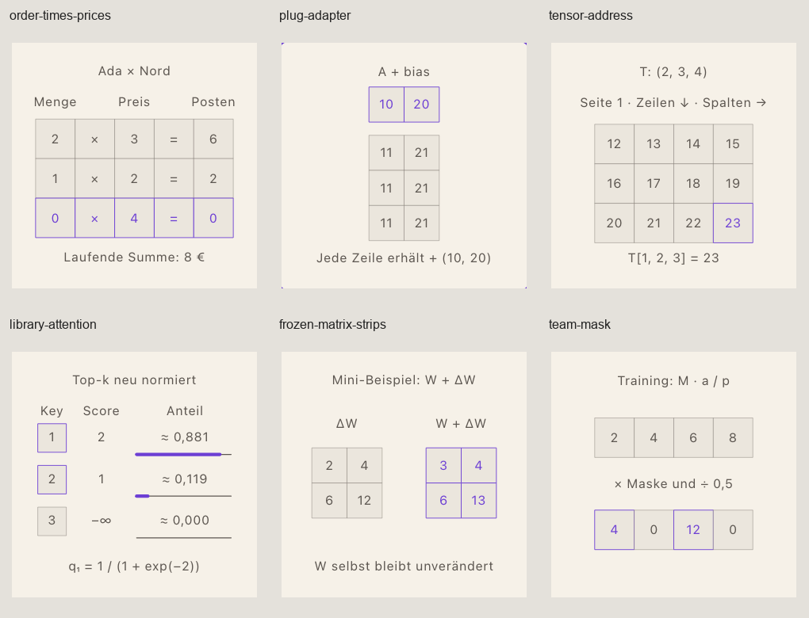

# Figuren S6b, F2

Basis: `1e017b749f0269ae738c967602225764b28f2688`, `figuren: Integration Welle 2`. Neuer normaler Worktree `/Users/no8/Desktop/life/Lifemaxxing/argmin-figuren-s6b`, Branch `feature/figuren-s6b`, vor Installation sauber. Keine Änderungen aus dem Hauptcheckout übernommen. Port ausschließlich 4407 mit `--strictPort`; kein Push, kein Merge.

## Entwurf vor Detailgeometrie

| Figur / Lektion | Lernfrage und vorhandene Lektüre | Darstellung, Daten und mobile Entscheidung |
|---|---|---|
| order-times-prices / l-linalg-matrices | Wie wird aus Bestellung und Preisliste ein Rechnungsbetrag? Die Lektüre liefert O, P, Dimensionsregel und Summenformel. | Frontale Zellgitter, Tabellen nacheinander; ausgewählte Zeile und Spalte als Paare mit laufender Summe. Danach Spaltenkombination als Übertragung mit dem geschützten Checkpoint. |
| plug-adapter / l-numpy-shape-contracts | Welche Achse wird gebroadcastet, was unterscheidet * und @? Der Text liefert (3,2) plus (2,) und die Fehlerform (3,). | Frontale, quadratische Zellen; Bias-Zeile und Wiederholungen sichtbar. Operatoren nacheinander. Einheitsquadrat und geschertes Bild mit gleichem Maßstab für den alten det-Checkpoint. |
| tensor-address / l-dl-tensors | Wie findet eine Adresse einen Wert und wie fließen Formen durch XW+b? Der Text liefert das MLP (32,8) → (32,16) → (32,3). | Zwei klar bezeichnete Seiten eines kleinen (2,3,4)-Tensors nacheinander; keine künstliche Tiefe. Große MLP-Arrays als beschriftete Blöcke, keine 512 winzigen Zellen. |
| library-attention / l-tf-attention | Wie werden Scores zu Mischgewichten, was sperrt die Kausalmaske? Der Text rechnet Q,K,V mit d_k=4. | Frontale Buch-/Value-Karten, Scores und maßstäbliche Gewichtsleisten; erst Handbeispiel, dann explizite Übertragung auf Logits (2,1,0), T=0,5, Top-k=2. Näherungen immer mit ≈. |
| frozen-matrix-strips / l-tf-finetuning | Was bleibt eingefroren und wie viele Parameter trägt BA? Die Lektüre verwendet 512×512, Rang 4 und ΔW=(α/r)BA. | Beschriftete Größenblöcke ohne vorgetäuschte Zellenmaßstäblichkeit; Mini-Matrix separat für exakte Werte. Keine Dicke als numerische Updategröße. |
| team-mask / l-dl-regularization | Welche Aktivierungen überleben die feste Maske? Der Text definiert p als Behaltewahrscheinlichkeit und invertiertes Dropout. | Vier frontale Aktivierungskarten, feste dokumentierte Ziehwerte, Maske, Trainingsausgabe, vollständige Inferenz. F7 Early Stopping unverändert erhalten. |

## Anfrage an S2b / Integrator, vor abhängiger Bedienung

Die Welle-2-Basis enthält keinen allgemeinen Auswahlvertrag. Feste Lektionsbeispiele und reine Modelle entstehen unabhängig davon. Keine private Runtime, kein Schema-/Compiler-Fork, keine Erweiterung der S4a-Antworthülle.

- Auswahlziel: Zelle über stabile Adresse `{page,row,column}`, Attention-Key über Tokenindex, Layer über Index. Tastaturäquivalent: fokussierbare Auswahlgruppe, Pfeile bewegen, Enter/Leertaste wählen; Zahlen-/Select-Eingabe als zugängliche Alternative. Trefferfläche mindestens 44 px. Rückmeldung: Umriss plus Adress-/Tokenbezeichnung, Live-Beschreibung des gewählten Werts. Auswahlzustand ist keine bewertete Antwort.
- Freie Parameter: Temperatur >0, Top-k als ganze Zahl im Tokenbereich, kompatible Tensorformen und Rang mit 1≤r≤min(d_in,d_out). Zahlenfeld samt Bereich, Rücksetzung, Modellvalidierung und getrenntem Vorhersagezustand pro Parametersatz im gemeinsamen Explore-Vertrag. Feste Szenen akzeptieren nur ihr autorisiertes Beispiel.
- `layer-chain`: Antwortdaten als `form.layerShapes` und `form.parameterCount` in der vorhandenen Hülle `{kind:'scene-build',schemaVersion:1,form,steps}`. `steps` enthält nur geordnete Modelloperationen, bei reiner Formularlösung eine leere Liste. Kein zusätzliches Feld an der Wurzel. Der zuzuweisende deterministische Vertrag prüft jede Verbindung und Summe inklusive Bias; alle passenden Ketten akzeptieren. Gemeinsamen Aufgabentyp und Eigentümer zuerst zuweisen.
- `construct-attention-mask`: Antwortdaten als boolesche Zeilenmatrix `form.mask` in derselben Hülle; gemeinsame Tastatur-Zellenauswahl und deterministischen Aufgabenvertrag zuerst zuweisen, vorhandene Familienlöser wiederverwenden. Keine lokale Bewertung implementiert.
- Hinweise bleiben gesperrt, bis Compiler-Lecksperre und Fall-/Nachbarvertrag tatsächlich freigegeben sind. Bei Formaufgaben weder Pinanzahl noch Ergebnisgeometrie verraten; Attention-Gewichte weder als Text noch als Balkenlänge, Helligkeit oder Value-Mischung darstellen.

## Basis-Gate

`npm ci --no-audit --no-fund`: 132 Pakete. Compiler und Inhaltsvalidierung bestanden, Node 2235 bestanden / 0 fehlgeschlagen, Typecheck samt Coverage bestanden. Basis ohne Releasebaum, daher vorhandene releaseabhängige Node-Prüfungen übersprungen.

## Umsetzung und fachliche Gegenrechnung

Alle sechs festen Figuren sind in ihren sechs tatsächlichen Lektionen eingebunden. Die Lektüre ist jeweils am fachlichen Übergang geteilt, der Rest steht in einer eigenen `*-f2-after.md`. Der Text der Lektionen bleibt erhalten; nur die überholte Ankündigung zweier Regler in `matrices.md` wurde auf das feste Beispiel berichtigt. Die vorhandene F7-Figur `early-stopping-flag` und deren Checkpoint in `dl-regularization` bleiben unverändert. Auch `activations` und der Lernratenverlauf in Fine-Tuning bleiben erhalten.

Die alten drei `.viz.json` sind bytegleich im lokalen Archiv `l-figuren-s6b-archive` erhalten. Das Archiv ist `local-only` und erhöht die öffentliche Lektionsabdeckung nicht. Öffentlicher Compiler: weiterhin 46 Kompetenzen, 50 Lektionen, 290 Aktivitäten. Registry und Public-Allowlist sind ausschließlich additiv ergänzt. Keine Änderung an Engine, Painter, Runtime, CSS, Schema, Compiler, S4a-Antwortformat oder IndexedDB-Version 3. Keine zweite Trace-Engine, keine neuen Tests oder Snapshot-Assertions.

Die 29 einmaligen Gegenproben stehen in [model-check.json](figuren-s6b/model-check.json):

- Matrixprodukt gegen NumPy: `O @ P = [[8,10],[11,11]]`. Auch Matrix-/Vektor-, Vektor-/Vektor-, Batch- und Fehlerformen sowie Nullachsen gegen NumPy geprüft.
- Broadcasting gegen NumPy und die Formberechnung aus `validate-shape-contract`; `(3,2)+(2,)` und `(3,2)+(3,1)` passen, `(3,2)+(3,)` scheitert. Die beiden MLP-Layer gegen `classify-shape-contract`: `(32,8)→(32,16)→(32,3)`, Parameter 144 und 51, zusammen 195.
- Die tatsächliche Python-Referenz aus `optimize-softmax-attention-mask` für das vollständige Handbeispiel, kausale Maske sowie Temperatur und Top-k ausgeführt. Unmaskiert erste Ausgabe etwa `(1,462117;0,537883)`, kausal exakt `(2,0)`. Das Modell rechnet ungerundet. Dezimalanzeigen tragen `≈`, die Balken verwenden die ungerundeten Gewichte.
- Die tatsächliche Python-Referenz aus `formula-lora-delta-apply` für Mini-Delta und Anwendung ausgeführt. `ΔW=[[2,4],[6,12]]`, `W+ΔW=[[3,4],[6,13]]`. Große Schicht: 262144 eingefrorene Gewichte, 4096 freie LoRA-Parameter. Große Blöcke sind ausdrücklich Formschemata ohne Zellskala.
- Dropout aus dokumentierten festen Ziehwerten: Maske `(1,0,1,0)`, Training `(4,0,12,0)`, Inferenz `(2,4,6,8)` ohne Maske oder weitere Skalierung. Erwartungswert über alle gleichwahrscheinlichen Masken unabhängig gegengeprüft.

Die drei Checkpoint-Objekte einschließlich Prompt, Hinweisen, Fehlerrückmeldungen und Toleranz sind wortgleich übernommen und gegen `predictValue` geprüft: `(4,7)`, `4`, `0,8807970779778823` innerhalb der alten Toleranz um `0,88`. Der Farbverweis „blauer Pfeil“ im geschützten Original wird ausdrücklich als Übertragung aus dem bisherigen Spaltenbild eingeordnet.

## Eigene Browser-Sichtung

148 Endzustände: alle 37 Schritte bei 375 und 1440 px, jeweils hell und dunkel. Eigene Bedienung mit Tastatur, Maus, Touch, Vorhersageformularen, Zurück/Weiter, Neustart und Reload. [Messungen](figuren-s6b/review/measurements.json), [separate Touch-Probe](figuren-s6b/review/touch.json), [Asset-Karte und Grenzen](figuren-s6b/assets.md).

- Tatsächliche mobile Bühne 309×309 px; Desktop 794×595,5 px. Kleinste Szenenschrift 16,066 px. Kleinster Text-/Trägerkontrast 5,101:1 einschließlich voller Deckkraft und tatsächlicher Papier-/Plattenflächen. Die gemeinsame kleine Schrittanzeige bleibt bei 13 px; deren CSS gehört S2b und wurde nicht als eigene Szenenschrift mitgemessen.
- Keine Textkollision, keine gemessene Textgruppe unter 8 px Abstand, keine Randverletzung unter 16 px. Zahlen sitzen in quadratischen Zellen. Die Tabellenköpfe sind einzeln auf ihren Spalten zentriert. Einheitsquadrat und Parallelogramm behalten denselben Maßstab auf beiden Achsen.
- Navigation mindestens 44 px hoch; letzter Knopf mindestens 17 px innerhalb der Karte. Vorhersage sperrt Weiter bis zur lesbaren Antwort; „Richtig.“ bleibt beim Vor-/Zurückgehen erhalten. Kein automatischer Eingabefokus.
- Alle sechs Szenen sind ausdrücklich `flat`: keine Orbit-Bewegung bei Ziehen oder Drehkürzel, kein Schatten. Die gesonderte vertikale Touch-Probe scrollt in allen zwölf Fällen um 159 bis 169 px. Eine frühere Messung unmittelbar nach Pos1 erfasste zusätzlich die Seitenbewegung; deren Rohdelta bleibt als `originalScrollDelta` erhalten und ist kein Touch-Nachweis.
- Beat wird nach Reload wiederhergestellt. Von vorn setzt auf den ersten Schritt zurück. Druckbeschreibung sichtbar, Forced Colors selbst angesehen. SVG-Namen und Live-Beschreibung kommen aus demselben Szenenmodell.

Alle 24 Szenen-Kontaktbögen und die notwendigen mobilen Einzelbilder wurden selbst geöffnet und angesehen. Die Sichtung korrigierte zu enge Matrix-/Ergebnisabstände, uneindeutige Spaltenköpfe sowie eine unbeabsichtigte Füllung der LoRA-Update-Umrandung. Die jetzt transparente Umrandung lässt Matrixname und Form sichtbar. Die Bilder sind Review-Artefakte, keine Snapshot-Sammlung mit Assertions und keine Freigabe durch Noa.

[Mobil dunkel](figuren-s6b/review/overview-375-dark.png), [Desktop hell](figuren-s6b/review/overview-1440-light.png), [Desktop dunkel](figuren-s6b/review/overview-1440-dark.png), [Forced Colors](figuren-s6b/review/contact-forced-colors.png). Pro Szene liegen `contact-<szene>-<breite>-<theme>.png` und mobile Einzelbilder im selben Ordner.

## Abschluss-Gates auf Port 4407

Logs und Exitcodes: [gates/results.json](figuren-s6b/gates/results.json), [finaler Inhalts-/Release-Stand](figuren-s6b/gates/results-final.json).

| Gate | Ergebnis |
|---|---|
| Compiler / Inhaltsvalidierung | Bestanden, auch nach den letzten Layoutkorrekturen |
| Typecheck und Coverage | Bestanden, final erneut ausgeführt |
| Node | 2233 bestanden, 2 fehlgeschlagen, 5 übersprungen; konkrete veraltete Assertions unten |
| Release | Bestanden: 980 Dateien, 29,7 MB, Public-/Leak-/Lizenz- und Next-Build-Validierung enthalten |
| Release-Negativprüfungen | 12 bestanden, 0 fehlgeschlagen |
| Project-Runner | 20 bestanden |
| Chromium Dev | 96 bestanden, 1 fehlgeschlagen, 25 übersprungen; alter direkter Viz-Aufruf unten |
| Chromium Release | 94 bestanden, 1 fehlgeschlagen, 27 übersprungen; derselbe alte direkte Viz-Aufruf |
| Shrink Complexity | Eigene acht Code-Dateien mit `bun lint --rule 'complexity: [error, 10]'` bestanden; Registry-/Allowlist-Änderungen sind reine Einträge |

Die Node-Fehler sind `tests/lesson_content_transformer.test.mjs:336` und `:355`: Die erste Assertion verlangt für jeden Nicht-`visualization`-Block eine `.md`, kennt also den vorhandenen gemeinsamen Typ `figure` noch nicht. Die zweite liest nur den ersten `worked-example` statt der zusammengehörigen Markdown-Blöcke und sucht dort `Direkter Check`. Der gesamte Text bleibt erhalten und wird öffentlich korrekt kompiliert. S6b ändert diese fremdbesessenen Tests nicht und behauptet kein grünes Gesamt-Gate.

Die fehlgeschlagene Dev-E2E-Prüfung `mobile-touch.spec.ts:95` erwartet noch `#/visualization/column-picture` als öffentlichen direkten Aufruf. Die alte Datei bleibt im lokalen Archiv, während die echte Lektion jetzt `order-times-prices` verwendet. Die sechs tatsächlichen Lektionsrouten sind separat in beiden Größen und Themes geprüft. Eine Anpassung des Bestandschecks gehört dem Integrator.

Die bestehende Release-Suite wurde mit `E2E_PORT=4407 npm run test:e2e:build -- --workers=4` und einem frisch strikt gebundenen Preview ausgeführt; kein fremder Server wurde wiederverwendet. [Release-Ergebnis](figuren-s6b/gates/chromium-release.json), [vollständiges Log](figuren-s6b/gates/chromium-release.log). Danach alle 37 Schritte der sechs eigenen Figuren im gebauten Release bis zum letzten Zustand bedient: sechs geladene Lektionen, keine Browserfehler, jeweils SVG-Deckkraft 1 und `data-settled=true`. [Nachweis](figuren-s6b/review/release-smoke.json), Einzelbilder `*-release-375.png` wurden selbst angesehen.

## Leistung und Chunks

Eigene Figuren: drei Läufe mit vierfacher CPU-Drosselung, alle Übergänge, Median der Laufmediane; Nachweis [performance/own.json](figuren-s6b/performance/own.json). Die sechs Szenen besitzen keine Drag-/Kamerafahrt, dafür wird kein künstlicher Nullwert als bestandene Messung ausgegeben. Gemeinsamer vorhandener Benchmark mit drei Läufen separat.

| Figur | 375 px, ms | 1440 px, ms |
|---|---:|---:|
| order-times-prices | 2,8 | 2,7 |
| plug-adapter | 1,9 | 1,9 |
| tensor-address | 1,8 | 2,1 |
| library-attention | 1,8 | 2,2 |
| frozen-matrix-strips | 1,4 | 1,5 |
| team-mask | 1,9 | 2,0 |

Alle eigenen Mediane liegen unter dem bevorzugten 4-ms-Ziel. Einzelne Maxima, etwa 9,1 ms bei der Bestellfigur, sind im Rohdatensatz enthalten und werden nicht mit dem Median gleichgesetzt. Die Szenen sind kleine frontale SVG-Darstellungen; kein zusätzlicher Canvas-Painter nötig.

Der bestehende gemeinsame Smoothie-Benchmark wurde unverändert dreimal ausgeführt, jeweils mit Exitcode 0. Median der Laufmediane bei 375/1440 px: Beat 5,3/5,9 ms, Drag 10,1/11,3 ms, Kamerafahrt 9,8/10,7 ms. Das bevorzugte Beatziel unter 4 ms sowie Drag/Kamera unter 8 ms bleiben gemeinsam offen. Das ist keine Budgetabnahme des gemeinsamen Renderers. [Läufe und Chunks](figuren-s6b/performance/shared-and-chunks.json); die drei vollständigen Benchmark-Logs liegen daneben.

Endgültige gzip-Größen mit Node v26.0.0, zlib 1.2.12, Standardstufe; [versionierter Messnachweis](figuren-s6b/performance/chunks-final.json):

| Chunk | gzip, Byte |
|---|---:|
| order-times-prices | 1567 |
| plug-adapter | 1509 |
| tensor-address | 1198 |
| library-attention | 1821 |
| frozen-matrix-strips | 1328 |
| team-mask | 999 |
| gemeinsam F2: Modelle und Frontalkomposition | 2407 |
| vorhandenes linalg-stage | 1018 |
| vorhandenes figure-kit | 5948 |
| vorhandene FigureRuntime | 9992 |

Alle eigenen Szenen liegen deutlich unter 12000 Byte. Die Runtime-Grenze ist kompressorabhängig: Dieselbe unveränderte Runtime-Datei ergibt mit Bun 1.4.4 im Context-Werkzeug 10028 Byte, also weiterhin über dem dort zuvor dokumentierten strikten 10000-Byte-Ziel. Der native Node-Wert liegt nur acht Byte darunter. S6b behauptet keinen Runtime-Budgetfix; S2b muss den gemeinsamen Messkompressor festlegen und die bestehende Grenze bearbeiten. Shared-Chunks sind ausdrücklich separat ausgewiesen.

## Offene Abnahme und Übergabe

Feste Lektionsfiguren und Modelle sind umgesetzt und selbst visuell geprüft. Direkte Auswahl, freie Parameter, `layer-chain`, Masken-Aufgabe und sichere Hinweise bleiben bis zur seriellen Übergabe der angefragten gemeinsamen Verträge offen. Keine Bedienung eines noch nicht integrierten Nachbarzweigs vorausgesetzt. Noas visuelle Freigabe bleibt offen.

Zusätzlicher Diagnosehinweis an S2b: Bei erzwungenem gemeinsamem `cameraTransition: cut` wurde während Dev-Navigation/Neuladungen ein Zustand mit `data-settled=true`, aber SVG-Deckkraft `0.958` beobachtet (`library-attention`, Schrittindex 6). Ein Zusammenhang mit HMR ist nicht isoliert; das ist keine nachgewiesene Engine-Regression. Die eigenen Figuren erzwingen diese zusätzliche SVG-Überblendung nicht; ihre reinen Posen blenden die Zustandsblätter selbst in 150 ms über. Die finalen Aufnahmen wurden ausschließlich bei `data-settled=true` und SVG-Deckkraft 1 erstellt. Keine Änderung am gemeinsamen Engine-Code.

Dev- und Preview-Server sind beendet; Port 4407 ist abschließend frei. Basis und Branch wurden erneut geprüft. Implementierung: lokaler Commit `00c3719` (`figuren(s6b): Matrix- und Tensorfiguren in Lektionen integrieren`), Prüfnachweise und Digest in einem anschließenden lokalen Dokumentationscommit. Ausschließlich `feature/figuren-s6b`; kein Push und kein Merge in `feature/figuren`.
